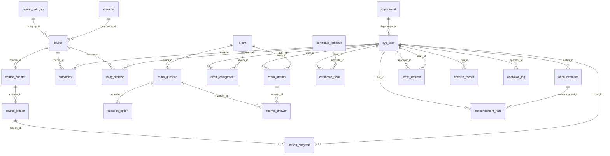

# 云舒艺境 · 数据库表结构文档

> 生成日期：2026-11-22  
> 数据源：[`sql/database.sql`](./sql/database.sql) 的 DDL 部分（唯一基准）  
> 数据库：`enterprise_academy`，MySQL 8.0+ / InnoDB / utf8mb4

本文档描述当前生产结构的最终状态：**23 张业务表 + 6 个在用视图**。历史统计视图 `v_department_stats` 因无任何代码引用已删除；部门/学员统计由管理端接口直接查询业务表获得。

---

## 一、总体约定

- 主键统一 `BIGINT UNSIGNED AUTO_INCREMENT`，业务编码单独成列并加唯一索引。
- 状态字段统一 `TINYINT`，枚举写在字段注释中，不使用 MySQL `ENUM`。
- 业务表普遍带 `created_at`、`updated_at`、`deleted_at`；`deleted_at IS NULL` 表示未删除。
- 可派生统计（学时、完成门数、证书数、题数、待办数）不落业务表，由视图或接口实时计算。
- 学习进度采用两层：`enrollment` 记课程级进度，`lesson_progress` 记课时级完成明细，`study_session` 记学时流水。
- 往期考试是「某人的答卷」：`exam` 是试卷定义，`exam_attempt` 是一次作答，`attempt_answer` 是逐题明细。

### 枚举字典

| 字段 | 取值 |
| --- | --- |
| `sys_user.role` | 1 学员；2 管理员 |
| `sys_user.account_status` | 1 正常；2 禁用 |
| `department.status` | 1 启用；2 停用 |
| `course.status` | 1 草稿；2 已上架；3 已下架 |
| `enrollment.status` | 1 未开始；2 学习中；3 已完成 |
| `exam.status` | 1 草稿；2 未开始；3 进行中；4 已结束 |
| `exam_question.type` | 1 单选；2 多选；3 判断；4 应用/简答 |
| `exam_assignment.status` | 1 待参加；2 已完成；3 已逾期 |
| `exam_attempt.status` | 1 作答中；2 已交卷待评分；3 已评分；4 系统强制交卷 |
| `certificate_issue.status` | 1 待发放；2 已发放；3 已撤销 |
| `announcement.status` | 1 草稿；2 已发布 |
| `leave_request.status` | 1 待审批；2 已通过；3 已驳回 |
| `checkin_record.status` | 1 正常；2 迟到；3 缺勤；4 早退 |

---

## 二、对象总览

| 分组 | 业务表 | 视图 |
| --- | --- | --- |
| 组织与账号 | 3 | 1 |
| 课程目录 | 4 | 1 |
| 学习过程 | 3 | 1 |
| 考试与题库 | 6 | 2 |
| 证书 | 2 | 0 |
| 公告与消息 | 2 | 0 |
| 考勤与请假 | 2 | 0 |
| 操作日志 | 1 | 0 |
| 系统与管理 | 0 | 1 |
| **合计** | **23** | **6** |

### 表清单

| 表名 | 所属分组 | 说明 |
| --- | --- | --- |
| `department` | 组织与账号 | 部门 |
| `sys_user` | 组织与账号 | 平台用户（学员 + 管理员） |
| `instructor` | 组织与账号 | 讲师档案 |
| `course_category` | 课程目录 | 课程一级分类 |
| `course` | 课程目录 | 课程 |
| `course_chapter` | 课程目录 | 课程章节 |
| `course_lesson` | 课程目录 | 课时（章节下的小节） |
| `enrollment` | 学习过程 | 选课与学习进度 |
| `lesson_progress` | 学习过程 | 课时级完成明细 |
| `study_session` | 学习过程 | 学时流水（个人看板月度趋势的数据源） |
| `exam` | 考试与题库 | 考试/测评 |
| `exam_question` | 考试与题库 | 题目 |
| `question_option` | 考试与题库 | 题目选项 |
| `exam_assignment` | 考试与题库 | 考试指派（谁该考哪场） |
| `exam_attempt` | 考试与题库 | 答卷 |
| `attempt_answer` | 考试与题库 | 逐题作答明细 |
| `certificate_template` | 证书 | 证书模板（种类） |
| `certificate_issue` | 证书 | 证书签发实例 |
| `announcement` | 公告与消息 | 企业培训公告 |
| `announcement_read` | 公告与消息 | 公告已读回执 |
| `leave_request` | 考勤与请假 | 培训请假申请 |
| `checkin_record` | 考勤与请假 | 培训签到/签退记录 |
| `operation_log` | 操作日志 | 后台操作动态 |

### 视图清单

| 视图 | 说明 | 使用方 |
| --- | --- | --- |
| `v_learner_profile` | 学员档案、首页欢迎区和管理端学员列表的派生字段，避免把学时/完成门数/证书数写回用户表。 | `SysUserMapper` |
| `v_course_progress` | 学员端课程卡片的进度、徽章文案与断点续学信息。 | `EnrollmentMapper` |
| `v_exam_overview` | 考试管理列表的题数与参与人次真实口径；使用子查询避免一对多连接造成乘法放大。 | `ExamMapper` |
| `v_monthly_study_hours` | 个人学习看板的按月学时趋势，替代原型中写死的 SVG 数值。 | `SysUserMapper` |
| `v_exam_metrics` | 考评中心待参加、作答中、往期已考、平均分与通过率指标。 | `ExamMapper` |
| `v_admin_pending` | 管理端侧栏与仪表盘的待办角标（待审批请假、待发放证书、公告草稿、进行中考试）。 | `SysUserMapper` |

---

## 三、表关系



> 说明：`exam_question.exam_id` 为空表示未组卷的备用题；`sys_user.department_id`、多个 `*_by`/`*_id` 字段可为空，删除引用对象时按外键规则置空或级联删除。

---

## 四、业务表字段明细

### 4.1 组织与账号

#### `department` — 部门

| 字段 | 类型 / 约束 | 可空 | 说明 |
| --- | --- | --- | --- |
| `id` | `BIGINT UNSIGNED NOT NULL AUTO_INCREMENT` | 否 | 主键 ID |
| `name` | `VARCHAR(64)     NOT NULL` | 否 | 部门名称 |
| `manager_name` | `VARCHAR(64)     NULL` | 是 | 部门负责人姓名 |
| `description` | `VARCHAR(255)    NULL` | 是 | 部门职责说明 |
| `status` | `TINYINT         NOT NULL DEFAULT 1` | 否 | 1 启用 2 停用 |
| `sort_no` | `INT             NOT NULL DEFAULT 0` | 否 | 排序序号，越小越靠前 |
| `created_at` | `DATETIME        NOT NULL DEFAULT CURRENT_TIMESTAMP` | 否 | 创建时间 |
| `updated_at` | `DATETIME        NOT NULL DEFAULT CURRENT_TIMESTAMP ON UPDATE CURRENT_TIMESTAMP` | 否 | 更新时间 |
| `deleted_at` | `DATETIME        NULL` | 是 | 软删除时间，NULL = 未删除 |

**主键 / 索引 / 外键**

```sql
PRIMARY KEY (id)
UNIQUE KEY uk_department_name (name)
KEY idx_department_status (status, deleted_at)
```

#### `sys_user` — 平台用户（学员 + 管理员）

| 字段 | 类型 / 约束 | 可空 | 说明 |
| --- | --- | --- | --- |
| `id` | `BIGINT UNSIGNED NOT NULL AUTO_INCREMENT` | 否 | 主键 ID |
| `employee_no` | `VARCHAR(32)     NOT NULL` | 否 | 工号，登录账号 |
| `password_hash` | `VARCHAR(128)    NOT NULL DEFAULT ''` | 否 | 口令散列；演示种子为空串 |
| `name` | `VARCHAR(64)     NOT NULL` | 否 | 姓名 |
| `department_id` | `BIGINT UNSIGNED NULL` | 是 | 所属部门 ID |
| `job_title` | `VARCHAR(64)     NULL` | 是 | 职位，如 高级研发工程师 |
| `avatar_url` | `VARCHAR(512)    NULL` | 是 | 头像地址 |
| `gender` | `VARCHAR(8)      NULL` | 是 | 性别：男 / 女 |
| `age` | `INT             NULL` | 是 | 年龄 |
| `phone` | `VARCHAR(32)     NULL` | 是 | 手机号 |
| `email` | `VARCHAR(128)    NULL` | 是 | 邮箱 |
| `role` | `TINYINT         NOT NULL DEFAULT 1` | 否 | 1 学员 2 管理员 |
| `account_status` | `TINYINT         NOT NULL DEFAULT 1` | 否 | 1 正常 2 禁用 |
| `last_active_at` | `DATETIME        NULL` | 是 | 最近活跃时间 |
| `onboarding_completed_at` | `DATETIME NULL` | 是 | 入职手册阅读完成时间，NULL = 未完成 |
| `created_at` | `DATETIME        NOT NULL DEFAULT CURRENT_TIMESTAMP` | 否 | 创建时间 |
| `updated_at` | `DATETIME        NOT NULL DEFAULT CURRENT_TIMESTAMP ON UPDATE CURRENT_TIMESTAMP` | 否 | 更新时间 |
| `deleted_at` | `DATETIME        NULL` | 是 | 软删除时间，NULL = 未删除 |

**主键 / 索引 / 外键**

```sql
PRIMARY KEY (id)
UNIQUE KEY uk_user_employee_no (employee_no)
KEY idx_user_department (department_id)
KEY idx_user_list (role, account_status, deleted_at)
CONSTRAINT fk_user_department FOREIGN KEY (department_id) REFERENCES department (id) ON DELETE SET NULL
```

#### `instructor` — 讲师档案

| 字段 | 类型 / 约束 | 可空 | 说明 |
| --- | --- | --- | --- |
| `id` | `BIGINT UNSIGNED NOT NULL AUTO_INCREMENT` | 否 | 主键 ID |
| `name` | `VARCHAR(64)     NOT NULL` | 否 | 讲师姓名或机构名 |
| `title` | `VARCHAR(64)     NULL` | 是 | 讲师头衔，如 资深架构师 |
| `created_at` | `DATETIME        NOT NULL DEFAULT CURRENT_TIMESTAMP` | 否 | 创建时间 |
| `updated_at` | `DATETIME        NOT NULL DEFAULT CURRENT_TIMESTAMP ON UPDATE CURRENT_TIMESTAMP` | 否 | 更新时间 |

**主键 / 索引 / 外键**

```sql
PRIMARY KEY (id)
UNIQUE KEY uk_instructor_name_title (name, title)
```

### 4.2 课程目录

#### `course_category` — 课程一级分类

| 字段 | 类型 / 约束 | 可空 | 说明 |
| --- | --- | --- | --- |
| `id` | `BIGINT UNSIGNED NOT NULL AUTO_INCREMENT` | 否 | 主键 ID |
| `code` | `VARCHAR(32)     NOT NULL` | 否 | core / tech / product / leadership / compliance |
| `label` | `VARCHAR(64)     NOT NULL` | 否 | 通识素养 / 技术研发 ... |
| `sort_no` | `INT             NOT NULL DEFAULT 0` | 否 | 排序序号，越小越靠前 |

**主键 / 索引 / 外键**

```sql
PRIMARY KEY (id)
UNIQUE KEY uk_course_category_code (code)
```

#### `course` — 课程

| 字段 | 类型 / 约束 | 可空 | 说明 |
| --- | --- | --- | --- |
| `id` | `BIGINT UNSIGNED NOT NULL AUTO_INCREMENT` | 否 | 主键 ID |
| `title` | `VARCHAR(200)    NOT NULL` | 否 | 课程名称 |
| `category_id` | `BIGINT UNSIGNED NOT NULL` | 否 | 一级分类 ID |
| `subcategory_label` | `VARCHAR(64)     NULL` | 是 | 卡片二级标签，如 研发架构 |
| `instructor_id` | `BIGINT UNSIGNED NULL` | 是 | 讲师 ID |
| `thumbnail_url` | `VARCHAR(512)    NULL` | 是 | 封面图地址 |
| `summary` | `VARCHAR(500)    NULL` | 是 | 一句话简介 |
| `status` | `TINYINT         NOT NULL DEFAULT 1` | 否 | 1 草稿 2 已上架 3 已下架 |
| `created_by` | `BIGINT UNSIGNED NULL` | 是 | 创建人用户 ID |
| `created_at` | `DATETIME        NOT NULL DEFAULT CURRENT_TIMESTAMP` | 否 | 创建时间 |
| `updated_at` | `DATETIME        NOT NULL DEFAULT CURRENT_TIMESTAMP ON UPDATE CURRENT_TIMESTAMP` | 否 | 更新时间 |
| `deleted_at` | `DATETIME        NULL` | 是 | 软删除时间，NULL = 未删除 |

**主键 / 索引 / 外键**

```sql
PRIMARY KEY (id)
KEY idx_course_category (category_id, status)
KEY idx_course_list (status, deleted_at, updated_at)
CONSTRAINT fk_course_category FOREIGN KEY (category_id) REFERENCES course_category (id)
CONSTRAINT fk_course_instructor FOREIGN KEY (instructor_id) REFERENCES instructor (id) ON DELETE SET NULL
```

#### `course_chapter` — 课程章节

| 字段 | 类型 / 约束 | 可空 | 说明 |
| --- | --- | --- | --- |
| `id` | `BIGINT UNSIGNED NOT NULL AUTO_INCREMENT` | 否 | 主键 ID |
| `course_id` | `BIGINT UNSIGNED NOT NULL` | 否 | 所属课程 ID |
| `title` | `VARCHAR(200)    NOT NULL` | 否 | 章节标题 |
| `sort_no` | `INT             NOT NULL DEFAULT 0` | 否 | 排序序号，越小越靠前 |
| `created_at` | `DATETIME        NOT NULL DEFAULT CURRENT_TIMESTAMP` | 否 | 创建时间 |
| `updated_at` | `DATETIME        NOT NULL DEFAULT CURRENT_TIMESTAMP ON UPDATE CURRENT_TIMESTAMP` | 否 | 更新时间 |

**主键 / 索引 / 外键**

```sql
PRIMARY KEY (id)
KEY idx_chapter_course (course_id, sort_no)
CONSTRAINT fk_chapter_course FOREIGN KEY (course_id) REFERENCES course (id) ON DELETE CASCADE
```

#### `course_lesson` — 课时（章节下的小节）

| 字段 | 类型 / 约束 | 可空 | 说明 |
| --- | --- | --- | --- |
| `id` | `BIGINT UNSIGNED NOT NULL AUTO_INCREMENT` | 否 | 主键 ID |
| `chapter_id` | `BIGINT UNSIGNED NOT NULL` | 否 | 所属章节 ID |
| `title` | `VARCHAR(200)    NOT NULL` | 否 | 小节标题 |
| `duration_seconds` | `INT UNSIGNED    NOT NULL DEFAULT 0` | 否 | 课时时长（秒），与 video_url 指向的 MP4 真实时长一致（取整秒） |
| `video_url` | `VARCHAR(512)    NULL` | 是 | 为空时前端提示本节尚未上传视频，可手动完成并记录学时 |
| `sort_no` | `INT             NOT NULL DEFAULT 0` | 否 | 排序序号，越小越靠前 |
| `created_at` | `DATETIME        NOT NULL DEFAULT CURRENT_TIMESTAMP` | 否 | 创建时间 |
| `updated_at` | `DATETIME        NOT NULL DEFAULT CURRENT_TIMESTAMP ON UPDATE CURRENT_TIMESTAMP` | 否 | 更新时间 |

**主键 / 索引 / 外键**

```sql
PRIMARY KEY (id)
KEY idx_lesson_chapter (chapter_id, sort_no)
CONSTRAINT fk_lesson_chapter FOREIGN KEY (chapter_id) REFERENCES course_chapter (id) ON DELETE CASCADE
```

### 4.3 学习过程

#### `enrollment` — 选课与学习进度

| 字段 | 类型 / 约束 | 可空 | 说明 |
| --- | --- | --- | --- |
| `id` | `BIGINT UNSIGNED NOT NULL AUTO_INCREMENT` | 否 | 主键 ID |
| `user_id` | `BIGINT UNSIGNED NOT NULL` | 否 | 学员用户 ID |
| `course_id` | `BIGINT UNSIGNED NOT NULL` | 否 | 课程 ID |
| `status` | `TINYINT         NOT NULL DEFAULT 1` | 否 | 1 未开始 2 学习中 3 已完成 |
| `progress_percent` | `TINYINT UNSIGNED NOT NULL DEFAULT 0` | 否 | 缓存：0-100，由后端按完成课时推进 |
| `completed_lesson_count` | `INT UNSIGNED    NOT NULL DEFAULT 0` | 否 | 已完成小节数 |
| `study_hours` | `DECIMAL(6,2)    NOT NULL DEFAULT 0` | 否 | 缓存：该门课已投入学时 |
| `started_at` | `DATETIME        NULL` | 是 | 开始学习时间 |
| `last_studied_at` | `DATETIME        NULL` | 是 | 断点续学时间 |
| `created_at` | `DATETIME        NOT NULL DEFAULT CURRENT_TIMESTAMP` | 否 | 创建时间 |
| `updated_at` | `DATETIME        NOT NULL DEFAULT CURRENT_TIMESTAMP ON UPDATE CURRENT_TIMESTAMP` | 否 | 更新时间 |

**主键 / 索引 / 外键**

```sql
PRIMARY KEY (id)
UNIQUE KEY uk_enrollment (user_id, course_id)
KEY idx_enrollment_course (course_id, status)
KEY idx_enrollment_recent (user_id, last_studied_at)
CONSTRAINT fk_enrollment_user FOREIGN KEY (user_id) REFERENCES sys_user (id) ON DELETE CASCADE
CONSTRAINT fk_enrollment_course FOREIGN KEY (course_id) REFERENCES course (id) ON DELETE CASCADE
```

#### `lesson_progress` — 课时级完成明细

| 字段 | 类型 / 约束 | 可空 | 说明 |
| --- | --- | --- | --- |
| `id` | `BIGINT UNSIGNED NOT NULL AUTO_INCREMENT` | 否 | 主键 ID |
| `user_id` | `BIGINT UNSIGNED NOT NULL` | 否 | 学员用户 ID |
| `lesson_id` | `BIGINT UNSIGNED NOT NULL` | 否 | 小节 ID |
| `is_completed` | `TINYINT(1)      NOT NULL DEFAULT 0` | 否 | 1 已完成 0 未完成 |
| `watched_seconds` | `INT UNSIGNED    NOT NULL DEFAULT 0` | 否 | 断点续播位置 |
| `updated_at` | `DATETIME        NOT NULL DEFAULT CURRENT_TIMESTAMP ON UPDATE CURRENT_TIMESTAMP` | 否 | 更新时间 |

**主键 / 索引 / 外键**

```sql
PRIMARY KEY (id)
UNIQUE KEY uk_lesson_progress (user_id, lesson_id)
CONSTRAINT fk_lp_user FOREIGN KEY (user_id) REFERENCES sys_user (id) ON DELETE CASCADE
CONSTRAINT fk_lp_lesson FOREIGN KEY (lesson_id) REFERENCES course_lesson (id) ON DELETE CASCADE
```

#### `study_session` — 学时流水（个人看板月度趋势的数据源）

| 字段 | 类型 / 约束 | 可空 | 说明 |
| --- | --- | --- | --- |
| `id` | `BIGINT UNSIGNED NOT NULL AUTO_INCREMENT` | 否 | 主键 ID |
| `user_id` | `BIGINT UNSIGNED NOT NULL` | 否 | 学员用户 ID |
| `course_id` | `BIGINT UNSIGNED NULL` | 是 | 课程 ID |
| `lesson_id` | `BIGINT UNSIGNED NULL` | 是 | 小节 ID |
| `started_at` | `DATETIME        NOT NULL` | 否 | 学习开始时间 |
| `duration_minutes` | `DECIMAL(6,1)    NOT NULL DEFAULT 0` | 否 | 本次学习时长（分钟） |
| `created_at` | `DATETIME        NOT NULL DEFAULT CURRENT_TIMESTAMP` | 否 | 创建时间 |

**主键 / 索引 / 外键**

```sql
PRIMARY KEY (id)
KEY idx_session_user_time (user_id, started_at)
KEY idx_session_user_lesson (user_id, lesson_id)
CONSTRAINT fk_session_user FOREIGN KEY (user_id) REFERENCES sys_user (id) ON DELETE CASCADE
CONSTRAINT fk_session_course FOREIGN KEY (course_id) REFERENCES course (id) ON DELETE SET NULL
```

### 4.4 考试与题库

#### `exam` — 考试/测评

| 字段 | 类型 / 约束 | 可空 | 说明 |
| --- | --- | --- | --- |
| `id` | `BIGINT UNSIGNED NOT NULL AUTO_INCREMENT` | 否 | 主键 ID |
| `code` | `VARCHAR(64)     NOT NULL` | 否 | 考试编号 ZK-... / CER-... |
| `title` | `VARCHAR(200)    NOT NULL` | 否 | 考试名称 |
| `organizer` | `VARCHAR(128)    NULL` | 是 | 主办方，如 技术合规部 · 2025Q2 |
| `status` | `TINYINT         NOT NULL DEFAULT 1` | 否 | 1 草稿 2 未开始 3 进行中 4 已结束 |
| `start_at` | `DATETIME        NULL` | 是 | mock timeWindow 前半段 |
| `end_at` | `DATETIME        NULL` | 是 | mock timeWindow 后半段 |
| `duration_minutes` | `SMALLINT UNSIGNED NOT NULL DEFAULT 60` | 否 | 考试时长（分钟） |
| `total_score` | `DECIMAL(5,1)    NOT NULL DEFAULT 100` | 否 | 卷面总分 |
| `pass_score` | `DECIMAL(5,1)    NOT NULL DEFAULT 60` | 否 | 及格分 |
| `created_by` | `BIGINT UNSIGNED NULL` | 是 | 创建人用户 ID |
| `created_at` | `DATETIME        NOT NULL DEFAULT CURRENT_TIMESTAMP` | 否 | 创建时间 |
| `updated_at` | `DATETIME        NOT NULL DEFAULT CURRENT_TIMESTAMP ON UPDATE CURRENT_TIMESTAMP` | 否 | 更新时间 |
| `deleted_at` | `DATETIME        NULL` | 是 | 软删除时间，NULL = 未删除 |

**主键 / 索引 / 外键**

```sql
PRIMARY KEY (id)
UNIQUE KEY uk_exam_code (code)
KEY idx_exam_status (status, deleted_at, end_at)
```

#### `exam_question` — 题目

| 字段 | 类型 / 约束 | 可空 | 说明 |
| --- | --- | --- | --- |
| `id` | `BIGINT UNSIGNED NOT NULL AUTO_INCREMENT` | 否 | 主键 ID |
| `exam_id` | `BIGINT UNSIGNED NULL` | 是 | 为空 = 未组卷的备用题 |
| `question_no` | `SMALLINT UNSIGNED NOT NULL DEFAULT 0` | 否 | 题号 |
| `type` | `TINYINT         NOT NULL DEFAULT 1` | 否 | 1 单选 2 多选 3 判断 4 应用/简答 |
| `score` | `DECIMAL(5,1)    NOT NULL DEFAULT 2` | 否 | 题目分值：单选 2 / 多选 4 / 判断 2 / 应用题 8（应用层兜底，此为单选默认值） |
| `title` | `VARCHAR(1000)   NOT NULL` | 否 | 题干 |
| `correct_answer` | `VARCHAR(16)     NULL` | 是 | 客观题答案：单选/判断 "A"，多选 "ABD"；主观题为空 |
| `reference_answer` | `TEXT           NULL` | 是 | 应用题参考答案/评分要点 |
| `analysis` | `VARCHAR(1000)   NULL` | 是 | 整题解析 |
| `created_at` | `DATETIME        NOT NULL DEFAULT CURRENT_TIMESTAMP` | 否 | 创建时间 |
| `updated_at` | `DATETIME        NOT NULL DEFAULT CURRENT_TIMESTAMP ON UPDATE CURRENT_TIMESTAMP` | 否 | 更新时间 |
| `deleted_at` | `DATETIME        NULL` | 是 | 软删除时间，NULL = 未删除 |

**主键 / 索引 / 外键**

```sql
PRIMARY KEY (id)
KEY idx_question_exam (exam_id, question_no)
KEY idx_question_type (type)
CONSTRAINT fk_question_exam FOREIGN KEY (exam_id) REFERENCES exam (id) ON DELETE CASCADE
```

#### `question_option` — 题目选项

| 字段 | 类型 / 约束 | 可空 | 说明 |
| --- | --- | --- | --- |
| `id` | `BIGINT UNSIGNED NOT NULL AUTO_INCREMENT` | 否 | 主键 ID |
| `question_id` | `BIGINT UNSIGNED NOT NULL` | 否 | 所属题目 ID |
| `option_key` | `CHAR(1)         NOT NULL` | 否 | A/B/C/D |
| `content` | `VARCHAR(1000)   NOT NULL` | 否 | 选项内容 |
| `explanation` | `VARCHAR(1000)   NULL` | 是 | 选项级解析（错题回顾用） |
| `sort_no` | `INT             NOT NULL DEFAULT 0` | 否 | 排序序号，越小越靠前 |

**主键 / 索引 / 外键**

```sql
PRIMARY KEY (id)
UNIQUE KEY uk_option (question_id, option_key)
CONSTRAINT fk_option_question FOREIGN KEY (question_id) REFERENCES exam_question (id) ON DELETE CASCADE
```

#### `exam_assignment` — 考试指派（谁该考哪场）

| 字段 | 类型 / 约束 | 可空 | 说明 |
| --- | --- | --- | --- |
| `id` | `BIGINT UNSIGNED NOT NULL AUTO_INCREMENT` | 否 | 主键 ID |
| `exam_id` | `BIGINT UNSIGNED NOT NULL` | 否 | 考试 ID |
| `user_id` | `BIGINT UNSIGNED NOT NULL` | 否 | 被指派学员用户 ID |
| `status` | `TINYINT         NOT NULL DEFAULT 1` | 否 | 1 待参加 2 已完成 3 已逾期 |
| `attempts_allowed` | `TINYINT UNSIGNED NOT NULL DEFAULT 1` | 否 | 允许作答次数 |
| `attempts_used` | `TINYINT UNSIGNED NOT NULL DEFAULT 0` | 否 | 已用作答次数 |
| `deadline_at` | `DATETIME        NULL` | 是 | 指派截止时间 |
| `created_at` | `DATETIME        NOT NULL DEFAULT CURRENT_TIMESTAMP` | 否 | 创建时间 |
| `updated_at` | `DATETIME        NOT NULL DEFAULT CURRENT_TIMESTAMP ON UPDATE CURRENT_TIMESTAMP` | 否 | 更新时间 |

**主键 / 索引 / 外键**

```sql
PRIMARY KEY (id)
UNIQUE KEY uk_assignment (exam_id, user_id)
KEY idx_assignment_user (user_id, status)
CONSTRAINT fk_assignment_exam FOREIGN KEY (exam_id) REFERENCES exam (id) ON DELETE CASCADE
CONSTRAINT fk_assignment_user FOREIGN KEY (user_id) REFERENCES sys_user (id) ON DELETE CASCADE
```

#### `exam_attempt` — 答卷

| 字段 | 类型 / 约束 | 可空 | 说明 |
| --- | --- | --- | --- |
| `id` | `BIGINT UNSIGNED NOT NULL AUTO_INCREMENT` | 否 | 主键 ID |
| `exam_id` | `BIGINT UNSIGNED NOT NULL` | 否 | 考试 ID |
| `user_id` | `BIGINT UNSIGNED NOT NULL` | 否 | 考生用户 ID |
| `attempt_no` | `TINYINT UNSIGNED NOT NULL DEFAULT 1` | 否 | 第几次作答 |
| `status` | `TINYINT         NOT NULL DEFAULT 3` | 否 | 1 作答中 2 已交卷待评分 3 已评分 4 系统强制交卷 |
| `started_at` | `DATETIME        NULL` | 是 | 开始作答时间 |
| `submitted_at` | `DATETIME        NULL` | 是 | 交卷时间，未交卷为 NULL |
| `remaining_seconds` | `INT UNSIGNED   NULL` | 是 | 作答中用于断点续考 |
| `objective_score` | `DECIMAL(5,1)    NULL` | 是 | 客观题得分 |
| `subjective_score` | `DECIMAL(5,1)    NULL` | 是 | 主观题得分 |
| `total_score` | `DECIMAL(5,1)    NULL` | 是 | 总得分 |
| `pass_score` | `DECIMAL(5,1)    NOT NULL DEFAULT 60` | 否 | 本场及格分 |
| `is_passed` | `TINYINT(1)      NULL` | 是 | 1 通过 0 未通过 |
| `wrong_count` | `SMALLINT UNSIGNED NOT NULL DEFAULT 0` | 否 | 答错题数 |
| `graded_at` | `DATETIME        NULL` | 是 | 判分完成时间 |
| `created_at` | `DATETIME        NOT NULL DEFAULT CURRENT_TIMESTAMP` | 否 | 创建时间 |
| `updated_at` | `DATETIME        NOT NULL DEFAULT CURRENT_TIMESTAMP ON UPDATE CURRENT_TIMESTAMP` | 否 | 更新时间 |

**主键 / 索引 / 外键**

```sql
PRIMARY KEY (id)
UNIQUE KEY uk_attempt_no (exam_id, user_id, attempt_no)
KEY idx_attempt_user (user_id, status)
CONSTRAINT fk_attempt_exam FOREIGN KEY (exam_id) REFERENCES exam (id) ON DELETE CASCADE
CONSTRAINT fk_attempt_user FOREIGN KEY (user_id) REFERENCES sys_user (id) ON DELETE CASCADE
```

#### `attempt_answer` — 逐题作答明细

| 字段 | 类型 / 约束 | 可空 | 说明 |
| --- | --- | --- | --- |
| `id` | `BIGINT UNSIGNED NOT NULL AUTO_INCREMENT` | 否 | 主键 ID |
| `attempt_id` | `BIGINT UNSIGNED NOT NULL` | 否 | 答卷 ID |
| `question_id` | `BIGINT UNSIGNED NOT NULL` | 否 | 题目 ID |
| `selected_keys` | `VARCHAR(16)     NULL` | 是 | 作答选项，多选按字母序拼接；主观题为空 |
| `answer_text` | `TEXT            NULL` | 是 | 主观题作答内容 |
| `is_flagged` | `TINYINT(1)      NOT NULL DEFAULT 0` | 否 | 标记待复查 |
| `score_gained` | `DECIMAL(5,1)    NULL` | 是 | 本题得分 |
| `answered_at` | `DATETIME        NULL` | 是 | 作答时间 |

**主键 / 索引 / 外键**

```sql
PRIMARY KEY (id)
UNIQUE KEY uk_attempt_answer (attempt_id, question_id)
CONSTRAINT fk_aa_attempt FOREIGN KEY (attempt_id) REFERENCES exam_attempt (id) ON DELETE CASCADE
CONSTRAINT fk_aa_question FOREIGN KEY (question_id) REFERENCES exam_question (id) ON DELETE CASCADE
```

### 4.5 证书

#### `certificate_template` — 证书模板（种类）

| 字段 | 类型 / 约束 | 可空 | 说明 |
| --- | --- | --- | --- |
| `id` | `BIGINT UNSIGNED NOT NULL AUTO_INCREMENT` | 否 | 主键 ID |
| `title` | `VARCHAR(200)    NOT NULL` | 否 | 证书名称 |
| `level_label` | `VARCHAR(64)     NULL` | 是 | LEVEL 4 · 专家级认证 |
| `category` | `VARCHAR(32)     NULL` | 是 | architecture / compliance / devops / ai |
| `issue_org` | `VARCHAR(128)    NULL` | 是 | 颁发机构 |
| `validity_months` | `SMALLINT UNSIGNED NULL` | 是 | 有效期月数，NULL = 长期有效 |
| `description` | `VARCHAR(1000)   NULL` | 是 | 证书说明 |
| `privilege_text` | `VARCHAR(255)    NULL` | 是 | 持证权益 |
| `created_at` | `DATETIME        NOT NULL DEFAULT CURRENT_TIMESTAMP` | 否 | 创建时间 |
| `updated_at` | `DATETIME        NOT NULL DEFAULT CURRENT_TIMESTAMP ON UPDATE CURRENT_TIMESTAMP` | 否 | 更新时间 |
| `deleted_at` | `DATETIME        NULL` | 是 | 软删除时间，NULL = 未删除 |

**主键 / 索引 / 外键**

```sql
PRIMARY KEY (id)
KEY idx_cert_tpl_category (category)
```

#### `certificate_issue` — 证书签发实例

| 字段 | 类型 / 约束 | 可空 | 说明 |
| --- | --- | --- | --- |
| `id` | `BIGINT UNSIGNED NOT NULL AUTO_INCREMENT` | 否 | 主键 ID |
| `template_id` | `BIGINT UNSIGNED NOT NULL` | 否 | 证书模板 ID |
| `user_id` | `BIGINT UNSIGNED NOT NULL` | 否 | 持证人 |
| `serial_number` | `VARCHAR(64)     NOT NULL` | 否 | 证书编号 |
| `issue_date` | `DATE            NULL` | 是 | NULL = 尚未签发 |
| `expire_date` | `DATE            NULL` | 是 | NULL = 长期有效 |
| `validity_label` | `VARCHAR(64)     NULL` | 是 | 展示文案，如 24 个月 (2027年到期) |
| `status` | `TINYINT         NOT NULL DEFAULT 1` | 否 | 1 待发放 2 已发放 3 已撤销 |
| `blockchain_hash` | `VARCHAR(128)    NULL` | 是 | 区块链存证哈希 |
| `issued_by` | `BIGINT UNSIGNED NULL` | 是 | 签发人用户 ID |
| `created_at` | `DATETIME        NOT NULL DEFAULT CURRENT_TIMESTAMP` | 否 | 创建时间 |
| `updated_at` | `DATETIME        NOT NULL DEFAULT CURRENT_TIMESTAMP ON UPDATE CURRENT_TIMESTAMP` | 否 | 更新时间 |
| `deleted_at` | `DATETIME        NULL` | 是 | 软删除时间，NULL = 未删除 |

**主键 / 索引 / 外键**

```sql
PRIMARY KEY (id)
UNIQUE KEY uk_cert_serial (serial_number)
KEY idx_cert_issue_user (user_id, status)
CONSTRAINT fk_ci_template FOREIGN KEY (template_id) REFERENCES certificate_template (id)
CONSTRAINT fk_ci_user FOREIGN KEY (user_id) REFERENCES sys_user (id) ON DELETE CASCADE
```

### 4.6 公告与消息

#### `announcement` — 企业培训公告

| 字段 | 类型 / 约束 | 可空 | 说明 |
| --- | --- | --- | --- |
| `id` | `BIGINT UNSIGNED NOT NULL AUTO_INCREMENT` | 否 | 主键 ID |
| `title` | `VARCHAR(200)    NOT NULL` | 否 | 公告标题 |
| `content` | `TEXT            NOT NULL` | 否 | 公告正文 |
| `is_top` | `TINYINT(1)      NOT NULL DEFAULT 0` | 否 | 1 置顶 0 普通 |
| `status` | `TINYINT         NOT NULL DEFAULT 1` | 否 | 1 草稿 2 已发布 |
| `author_id` | `BIGINT UNSIGNED NULL` | 是 | 发布人用户 ID |
| `author_name` | `VARCHAR(64)     NULL` | 是 | 冗余展示名，支持「系统自动」 |
| `publish_at` | `DATETIME        NULL` | 是 | 发布时间，草稿为 NULL |
| `created_at` | `DATETIME        NOT NULL DEFAULT CURRENT_TIMESTAMP` | 否 | 创建时间 |
| `updated_at` | `DATETIME        NOT NULL DEFAULT CURRENT_TIMESTAMP ON UPDATE CURRENT_TIMESTAMP` | 否 | 更新时间 |
| `deleted_at` | `DATETIME        NULL` | 是 | 软删除时间，NULL = 未删除 |

**主键 / 索引 / 外键**

```sql
PRIMARY KEY (id)
KEY idx_announcement_list (status, is_top, publish_at)
CONSTRAINT fk_announcement_author FOREIGN KEY (author_id) REFERENCES sys_user (id) ON DELETE SET NULL
```

#### `announcement_read` — 公告已读回执

| 字段 | 类型 / 约束 | 可空 | 说明 |
| --- | --- | --- | --- |
| `id` | `BIGINT UNSIGNED NOT NULL AUTO_INCREMENT` | 否 | 主键 ID |
| `announcement_id` | `BIGINT UNSIGNED NOT NULL` | 否 | 公告 ID |
| `user_id` | `BIGINT UNSIGNED NOT NULL` | 否 | 阅读人用户 ID |
| `read_at` | `DATETIME        NOT NULL DEFAULT CURRENT_TIMESTAMP` | 否 | 阅读时间 |

**主键 / 索引 / 外键**

```sql
PRIMARY KEY (id)
UNIQUE KEY uk_announcement_read (announcement_id, user_id)
CONSTRAINT fk_ar_announcement FOREIGN KEY (announcement_id) REFERENCES announcement (id) ON DELETE CASCADE
CONSTRAINT fk_ar_user FOREIGN KEY (user_id) REFERENCES sys_user (id) ON DELETE CASCADE
```

### 4.7 考勤与请假

#### `leave_request` — 培训请假申请

| 字段 | 类型 / 约束 | 可空 | 说明 |
| --- | --- | --- | --- |
| `id` | `BIGINT UNSIGNED NOT NULL AUTO_INCREMENT` | 否 | 主键 ID |
| `flow_no` | `VARCHAR(32)     NOT NULL` | 否 | 审批流水号 LV-20250518-004 |
| `user_id` | `BIGINT UNSIGNED NOT NULL` | 否 | 申请人用户 ID |
| `leave_type` | `VARCHAR(64)     NOT NULL` | 否 | 项目紧急发版 / 病假 / 因公外出 / 个人事务 |
| `start_date` | `DATE            NOT NULL` | 否 | 请假开始日期 |
| `end_date` | `DATE            NULL` | 是 | 单日请假可等于 start_date |
| `leave_days` | `DECIMAL(4,1)    NOT NULL DEFAULT 0.5` | 否 | 请假天数 |
| `reason` | `VARCHAR(1000)   NOT NULL` | 否 | 请假事由 |
| `status` | `TINYINT         NOT NULL DEFAULT 1` | 否 | 1 待审批 2 已通过 3 已驳回 |
| `submitted_at` | `DATETIME        NOT NULL` | 否 | 提交时间 |
| `approver_id` | `BIGINT UNSIGNED NULL` | 是 | 审批人用户 ID |
| `approved_at` | `DATETIME        NULL` | 是 | 审批时间 |
| `approve_remark` | `VARCHAR(500)    NULL` | 是 | 审批意见 |
| `created_at` | `DATETIME        NOT NULL DEFAULT CURRENT_TIMESTAMP` | 否 | 创建时间 |
| `updated_at` | `DATETIME        NOT NULL DEFAULT CURRENT_TIMESTAMP ON UPDATE CURRENT_TIMESTAMP` | 否 | 更新时间 |
| `deleted_at` | `DATETIME        NULL` | 是 | 软删除时间，NULL = 未删除 |

**主键 / 索引 / 外键**

```sql
PRIMARY KEY (id)
UNIQUE KEY uk_leave_flow_no (flow_no)
KEY idx_leave_status (status, submitted_at)
KEY idx_leave_user (user_id, status)
CONSTRAINT fk_leave_user FOREIGN KEY (user_id) REFERENCES sys_user (id) ON DELETE CASCADE
CONSTRAINT fk_leave_approver FOREIGN KEY (approver_id) REFERENCES sys_user (id) ON DELETE SET NULL
```

#### `checkin_record` — 培训签到/签退记录

| 字段 | 类型 / 约束 | 可空 | 说明 |
| --- | --- | --- | --- |
| `id` | `BIGINT UNSIGNED NOT NULL AUTO_INCREMENT` | 否 | 主键 ID |
| `user_id` | `BIGINT UNSIGNED NOT NULL` | 否 | 签到人用户 ID |
| `checkin_date` | `DATE            NOT NULL` | 否 | 签到日期 |
| `check_in_time` | `TIME            NULL` | 是 | 缺勤为 NULL |
| `check_out_time` | `TIME            NULL` | 是 | 签退时间，未签退为 NULL |
| `status` | `TINYINT         NOT NULL DEFAULT 1` | 否 | 1 正常 2 迟到 3 缺勤 4 早退 |
| `created_at` | `DATETIME        NOT NULL DEFAULT CURRENT_TIMESTAMP` | 否 | 创建时间 |
| `updated_at` | `DATETIME        NOT NULL DEFAULT CURRENT_TIMESTAMP ON UPDATE CURRENT_TIMESTAMP` | 否 | 更新时间 |

**主键 / 索引 / 外键**

```sql
PRIMARY KEY (id)
UNIQUE KEY uk_checkin_day (user_id, checkin_date)
KEY idx_checkin_date (checkin_date, status)
CONSTRAINT fk_checkin_user FOREIGN KEY (user_id) REFERENCES sys_user (id) ON DELETE CASCADE
```

### 4.8 操作日志

#### `operation_log` — 后台操作动态

| 字段 | 类型 / 约束 | 可空 | 说明 |
| --- | --- | --- | --- |
| `id` | `BIGINT UNSIGNED NOT NULL AUTO_INCREMENT` | 否 | 主键 ID |
| `log_type` | `VARCHAR(16)     NOT NULL` | 否 | course / user / exam / notice / approve |
| `content` | `VARCHAR(255)    NOT NULL` | 否 | 操作内容描述 |
| `operator_id` | `BIGINT UNSIGNED NULL` | 是 | 操作人用户 ID |
| `operator_name` | `VARCHAR(64)     NULL` | 是 | 冗余展示名，支持「系统自动」 |
| `ref_type` | `VARCHAR(32)     NULL` | 是 | 关联业务类型，如 course / exam |
| `ref_id` | `BIGINT UNSIGNED NULL` | 是 | 关联业务 ID |
| `occurred_at` | `DATETIME        NOT NULL` | 否 | 操作发生时间 |
| `created_at` | `DATETIME        NOT NULL DEFAULT CURRENT_TIMESTAMP` | 否 | 创建时间 |

**主键 / 索引 / 外键**

```sql
PRIMARY KEY (id)
KEY idx_log_time (occurred_at)
CONSTRAINT fk_log_operator FOREIGN KEY (operator_id) REFERENCES sys_user (id) ON DELETE SET NULL
```

---

## 五、视图字段明细

### 5.1 `v_learner_profile`

学员档案、首页欢迎区和管理端学员列表的派生字段，避免把学时/完成门数/证书数写回用户表。

**使用方：** `SysUserMapper`

**输出字段：** `user_id`、`employee_no`、`name`、`department`、`job_title`、`avatar_url`、`role`、`account_status`、`last_active_at`、`learning_hours`、`completed_courses`、`certificate_count`

**定义：**

```sql
CREATE OR REPLACE VIEW v_learner_profile AS
SELECT
  u.id                                AS user_id,
  u.employee_no,
  u.name,
  d.name                              AS department,
  u.job_title,
  u.avatar_url,
  u.role,
  u.account_status,
  u.last_active_at,
  IFNULL((SELECT SUM(e.study_hours) FROM enrollment e
           WHERE e.user_id = u.id), 0)                    AS learning_hours,
  (SELECT COUNT(*) FROM enrollment e
    WHERE e.user_id = u.id AND e.status = 3)              AS completed_courses,
  (SELECT COUNT(*) FROM certificate_issue c
    WHERE c.user_id = u.id AND c.status = 2 AND c.deleted_at IS NULL) AS certificate_count
FROM sys_user u
LEFT JOIN department d ON d.id = u.department_id
WHERE u.deleted_at IS NULL
```

### 5.2 `v_course_progress`

学员端课程卡片的进度、徽章文案与断点续学信息。

**使用方：** `EnrollmentMapper`

**输出字段：** `user_id`、`course_id`、`title`、`status`、`progress_percent`、`completed_lesson_count`、`study_hours`、`last_studied_at`、`badge_text`

**定义：**

```sql
CREATE OR REPLACE VIEW v_course_progress AS
SELECT
  e.user_id,
  c.id                                AS course_id,
  c.title,
  e.status,
  e.progress_percent,
  e.completed_lesson_count,
  e.study_hours,
  e.last_studied_at,
  CASE
    WHEN e.status = 3 THEN '已结课'
    WHEN e.status = 2 THEN CONCAT('学习中 · ', e.progress_percent, '%')
    ELSE '未开始'
  END                                 AS badge_text
FROM enrollment e
JOIN course c ON c.id = e.course_id
WHERE c.deleted_at IS NULL
```

### 5.3 `v_exam_overview`

考试管理列表的题数与参与人次真实口径；使用子查询避免一对多连接造成乘法放大。

**使用方：** `ExamMapper`

**输出字段：** `id`、`code`、`title`、`status`、`pass_score`、`question_count`、`attempt_count`

**定义：**

```sql
CREATE OR REPLACE VIEW v_exam_overview AS
SELECT
  x.id,
  x.code,
  x.title,
  x.status,
  x.pass_score,
  (SELECT COUNT(*) FROM exam_question q
    WHERE q.exam_id = x.id AND q.deleted_at IS NULL)      AS question_count,
  (SELECT COUNT(*) FROM exam_attempt a WHERE a.exam_id = x.id) AS attempt_count
FROM exam x
WHERE x.deleted_at IS NULL
```

### 5.4 `v_monthly_study_hours`

个人学习看板的按月学时趋势，替代原型中写死的 SVG 数值。

**使用方：** `SysUserMapper`

**输出字段：** `user_id`、`ym`、`study_hours`

**定义：**

```sql
CREATE OR REPLACE VIEW v_monthly_study_hours AS
SELECT
  s.user_id,
  DATE_FORMAT(s.started_at, '%Y-%m')  AS ym,
  ROUND(SUM(s.duration_minutes) / 60, 1) AS study_hours
FROM study_session s
GROUP BY s.user_id, DATE_FORMAT(s.started_at, '%Y-%m')
```

### 5.5 `v_exam_metrics`

考评中心待参加、作答中、往期已考、平均分与通过率指标。

**使用方：** `ExamMapper`

**输出字段：** `user_id`、`pending_count`、`in_progress_count`、`finished_count`、`avg_past_score`、`pass_rate`

**定义：**

```sql
CREATE OR REPLACE VIEW v_exam_metrics AS
SELECT
  u.id                                                            AS user_id,
  (SELECT COUNT(*) FROM exam_assignment ast
    WHERE ast.user_id = u.id AND ast.status = 1)                  AS pending_count,
  (SELECT COUNT(*) FROM exam_attempt a
    WHERE a.user_id = u.id AND a.status = 1)                      AS in_progress_count,
  (SELECT COUNT(*) FROM exam_attempt a
    WHERE a.user_id = u.id AND a.status IN (3, 4))                AS finished_count,
  (SELECT ROUND(AVG(a.total_score), 1) FROM exam_attempt a
    WHERE a.user_id = u.id AND a.status IN (3, 4)
      AND a.total_score IS NOT NULL)                              AS avg_past_score,
  ROUND((SELECT COUNT(*) FROM exam_attempt a
    WHERE a.user_id = u.id AND a.status IN (3, 4) AND a.is_passed = 1) * 100.0
        / NULLIF((SELECT COUNT(*) FROM exam_attempt a
    WHERE a.user_id = u.id AND a.status IN (3, 4)), 0), 1)        AS pass_rate
FROM sys_user u
WHERE u.deleted_at IS NULL
```

### 5.6 `v_admin_pending`

管理端侧栏与仪表盘的待办角标（待审批请假、待发放证书、公告草稿、进行中考试）。

**使用方：** `SysUserMapper`

**输出字段：** `pending_leave_count`、`pending_cert_count`、`draft_notice_count`、`active_exam_count`

**定义：**

```sql
CREATE OR REPLACE VIEW v_admin_pending AS
SELECT
  (SELECT COUNT(*) FROM leave_request WHERE status = 1 AND deleted_at IS NULL)          AS pending_leave_count,
  (SELECT COUNT(*) FROM certificate_issue WHERE status = 1 AND deleted_at IS NULL)      AS pending_cert_count,
  (SELECT COUNT(*) FROM announcement WHERE status = 1 AND deleted_at IS NULL)           AS draft_notice_count,
  (SELECT COUNT(*) FROM exam WHERE status = 3 AND deleted_at IS NULL)                   AS active_exam_count
```

---

## 六、变更记录

- 2026-11-22：删除未被引用的统计视图 `v_department_stats`；DDL 增加重建时的 `DROP VIEW IF EXISTS` 保护。
- 2026-11-23：`sql/schema.sql`、`sql/seed.sql`、3 个 `migrate_*.sql` 与 `add_exam_questions.sql` 合并为唯一的 `sql/database.sql`，一次执行完成建库、建表和演示数据写入。
- 题目难度分类 `exam_question.difficulty` 已从结构中移除，当前表不包含该字段。
- 入职手册完成时间 `sys_user.onboarding_completed_at` 已纳入 `sys_user` 表结构。
