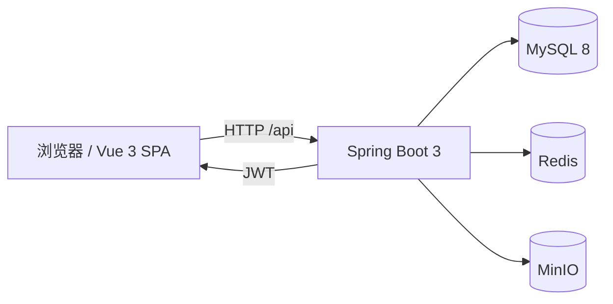

# 云舒艺境 · 企业数字化智能人才培养平台

基于 **Spring Boot + Vue 3** 的企业培训一体化平台，覆盖课程学习、研修通道、在线考试、考勤签到、请假审批、证书发放、公告通知与运营看板。

> 仓库地址：<https://github.com/jokerzhang-0717/Enterprise-Academy>
>
> 前端位于仓库根目录，后端位于 [`emp-server/`](./emp-server/)。


---

## ✨ 功能概览

### 学员端

- **首页看板**：学习统计、待办事项、公告、今日考勤、推荐课程。
- **课程中心**：课程分类、搜索、课程详情、报名、章节/课时学习。
- **课程播放器**：视频播放、学习进度、学习时长心跳、断点续学。
- **研修通道**：专题学习路径、通道课程与大纲。
- **在线考试**：我的考试、开始答题、逐题保存、切屏记录、交卷、往期成绩。
- **考勤签到**：今日状态、签到/签退、历史记录与统计。
- **请假申请**：提交、修改、撤销、审批进度。
- **证书中心**：我的证书、证书详情、证书验真。
- **公告与消息**：已发布公告、通知列表、未读数、已读/删除。
- **个人中心**：个人资料、修改密码、学习数据。

### 管理端

- **运营看板**：学员、课程、考试、证书、考勤等核心指标与待办。
- **学员管理**：学员列表、新增、编辑、启用/停用、重置密码。
- **部门管理**：部门树/列表、负责人、状态维护。
- **课程管理**：课程、章节、课时、分类、标签、讲师、上下架。
- **题库与考试**：题目导入/维护、组卷、发布、指派学员、答卷列表、主观题评分。
- **请假审批**：待审批列表、通过/驳回。
- **考勤管理**：签到记录查询、状态维护、统计。
- **证书管理**：证书模板、签发、编辑、撤销。
- **公告管理**：草稿、发布、置顶、附件。

---

## 🧱 技术栈

| 层级 | 技术 |
| --- | --- |
| 前端 | Vue 3、Vue Router 4、Vite、Tailwind CSS、Element Plus Icons、Lucide Vue |
| 后端 | Spring Boot 3.0、MyBatis-Plus 3.5、JWT（JJWT 0.12）、BCrypt |
| 数据库 | MySQL 8.0（InnoDB / utf8mb4） |
| 缓存 / 会话 | Redis（API 读缓存、学习计时会话） |
| 文件存储 | MinIO（S3 兼容对象存储） |
| 构建 | npm / Vite、Maven |
| API 文档 | OpenAPI 3.0（Apifox / Swagger Editor 可导入） |

---

## 🏗️ 系统架构



- 前端通过 Vite 开发代理或 Nginx 反向代理访问 `/api`。
- 后端默认端口 `8080`，上下文路径 `/api`。
- 文件上传支持服务端转发（小文件）和预签名直传（大文件/视频）。
- 登录使用 JWT，管理端接口额外校验 `role = 2`。

---

## 📁 目录结构

```text
.
├─ src/                        # Vue 3 前端
│  ├─ api/                     # API 客户端、接口封装、数据适配
│  ├─ components/              # 通用组件（Header、Sidebar、弹窗、分页等）
│  ├─ composables/             # 组合式函数（Toast、分页、确认框等）
│  ├─ router/                  # 路由与登录守卫
│  ├─ views/                   # 学员端页面
│  │  └─ admin/                # 管理端页面
│  ├─ App.vue                  # 应用外壳与视图分发
│  └─ main.js                  # 前端入口
├─ public/                     # 静态资源
├─ emp-server/                 # Spring Boot 后端
│  ├─ docs/                    # OpenAPI 文档与校验脚本
│  ├─ src/main/java/com/joker/emp/
│  │  ├─ common/               # 统一响应、分页、异常
│  │  ├─ config/               # MyBatis-Plus、CORS、缓存、MinIO
│  │  ├─ controller/           # 学员端 / 管理端 REST 接口
│  │  ├─ entity/               # 数据库实体
│  │  ├─ mapper/               # MyBatis-Plus Mapper
│  │  ├─ security/             # JWT、登录上下文、@AdminOnly
│  │  ├─ service/              # 业务逻辑
│  │  └─ storage/              # MinIO 上传 / 预签名 / 下载
│  ├─ src/main/resources/      # application.yml、Mapper XML
│  └─ src/test/                # 后端测试
├─ sql/                        # 建表、种子数据、增量脚本
├─ index.html                  # Vite HTML 入口
├─ vite.config.js              # Vite 配置（端口、代理、别名）
├─ package.json
└─ README.md
```

---

## 🚀 快速开始

### 1. 环境要求

| 软件 | 版本建议 | 说明 |
| --- | --- | --- |
| JDK | 17+ | 后端编译与运行 |
| Maven | 3.8+ | 后端构建 |
| Node.js | 20+（建议 22 LTS） | 前端开发与构建 |
| npm | 9+ | 前端依赖管理 |
| MySQL | 8.0+ | 业务数据库 |
| Redis | 6+ | 学习计时与 API 缓存 |
| MinIO | 最新稳定版 | 头像、课件、视频等文件存储 |

### 2. 初始化数据库

先创建数据库：

```bash
mysql -uroot -p -e "CREATE DATABASE IF NOT EXISTS enterprise_academy DEFAULT CHARACTER SET utf8mb4 COLLATE utf8mb4_unicode_ci;"
```

导入表结构和演示数据：

```bash
mysql -uroot -p enterprise_academy < sql/schema.sql
mysql -uroot -p enterprise_academy < sql/seed.sql
```

> `schema.sql` 会重建表结构，已有数据的环境请先备份，不要直接重复执行。
>
> 已有数据库升级题库知识点/难度字段时，备份后执行：
>
> ```bash
> mysql -uroot -p enterprise_academy < sql/migrate_exam_question_metadata.sql
> ```

### 3. 启动依赖服务

确保以下服务已启动：

- **MySQL**：默认 `127.0.0.1:3306`，数据库 `enterprise_academy`。
- **Redis**：默认 `127.0.0.1:6379`，用于学习计时和 API 读缓存。
- **MinIO**：默认 `http://127.0.0.1:9000`，控制台通常为 `http://127.0.0.1:9001`。

MinIO 本地启动示例：

```bash
minio server ./data --console-address ":9001"
```

后端启动时会自动创建 `MINIO_BUCKET`（默认 `emp-academy`）。

### 4. 启动后端

```bash
cd emp-server
mvn spring-boot:run
```

默认地址：`http://localhost:8080/api`

打包运行：

```bash
cd emp-server
mvn -DskipTests clean package
java -jar target/emp-server-0.0.1-SNAPSHOT.jar
```

生产/自定义环境变量示例（bash）：

```bash
export MYSQL_USERNAME=root
export MYSQL_PASSWORD='your-mysql-password'
export EMP_JWT_SECRET='replace-with-a-random-secret-at-least-32-bytes'
export MINIO_PUBLIC_READ=false
mvn spring-boot:run
```

PowerShell：

```powershell
$env:MYSQL_PASSWORD = "your-mysql-password"
$env:EMP_JWT_SECRET = "replace-with-a-random-secret-at-least-32-bytes"
$env:MINIO_PUBLIC_READ = "false"
mvn spring-boot:run
```

也可以直接在 IntelliJ IDEA 的 Run Configuration 中配置环境变量。

### 5. 启动前端

```bash
npm install
npm run dev
```

打开 <http://localhost:3000>。

开发环境下 Vite 会把 `/api` 代理到 `http://127.0.0.1:8080`，无需额外配置 CORS。

### 6. 演示账号

| 角色 | 工号 | 密码 | 访问范围 |
| --- | --- | --- | --- |
| 管理员 | `admin` | `123456` | 学员端 + `/api/admin/**` |
| 学员 | `EMP-2024098` | `123456` | 学员端 |

> 演示账号仅用于本地体验。`seed.sql` 中的种子用户 `password_hash` 为空时，后端会按演示口令 `123456` 校验；正式环境请立即修改密码并移除演示数据。

### 7. 验证登录

```bash
curl -X POST http://localhost:8080/api/auth/login \
  -H "Content-Type: application/json" \
  -d '{"employeeNo":"admin","password":"123456"}'
```

成功后会返回 `data.token` 与 `data.refreshToken`，后续请求携带：

```http
Authorization: Bearer <token>
```

访问令牌默认 15 分钟。过期后调用 `POST /api/auth/refresh` 并传入 `refreshToken` 换发新令牌；退出登录时调用 `POST /api/auth/logout` 吊销两类令牌。

---

## ⚙️ 环境变量

### 后端

配置位于 [`emp-server/src/main/resources/application.yml`](./emp-server/src/main/resources/application.yml)，可通过环境变量覆盖。

| 变量 | 默认值 | 说明 |
| --- | --- | --- |
| `MYSQL_USERNAME` | `root` | MySQL 用户名 |
| `MYSQL_PASSWORD` | 开发默认值 | MySQL 密码，生产必须覆盖 |
| `REDIS_HOST` | `127.0.0.1` | Redis 地址 |
| `REDIS_PORT` | `6379` | Redis 端口 |
| `REDIS_PASSWORD` | 空 | Redis 密码，无密码时留空 |
| `REDIS_DATABASE` | `0` | Redis DB 编号 |
| `API_RESPONSE_CACHE_TTL` | `1s` | 登录用户 API 读缓存 TTL |
| `EMP_JWT_SECRET` | 开发默认值 | JWT 签名密钥，生产必须覆盖，至少 32 字节 |
| `EMP_JWT_EXPIRE_MINUTES` | `15` | 访问令牌有效期（分钟） |
| `AUTH_REFRESH_TOKEN_DAYS` | `7` | 刷新令牌有效期（天） |
| `AUTH_MAX_LOGIN_ATTEMPTS` | `5` | 同一工号在窗口期内允许的登录失败次数 |
| `AUTH_MAX_LOGIN_IP_ATTEMPTS` | `30` | 同一 IP 在窗口期内允许的登录失败次数 |
| `AUTH_LOGIN_WINDOW_MINUTES` | `15` | 登录失败计数窗口（分钟） |
| `AUTH_MAX_REGISTER_ATTEMPTS` | `5` | 同一 IP 在窗口期内允许的注册次数 |
| `AUTH_REGISTER_WINDOW_MINUTES` | `60` | 注册限流窗口（分钟） |
| `MINIO_ENDPOINT` | `http://127.0.0.1:9000` | MinIO 地址 |
| `MINIO_ACCESS_KEY` | 开发默认值 | MinIO Access Key，生产必须覆盖 |
| `MINIO_SECRET_KEY` | 开发默认值 | MinIO Secret Key，生产必须覆盖 |
| `MINIO_BUCKET` | `emp-academy` | 存储桶，启动时自动创建 |
| `MINIO_PUBLIC_READ` | `true` | 是否给桶设置公共只读，生产建议 `false` |

### 前端

前端环境变量放在仓库根目录的 `.env.local`（不要提交到 Git）。

| 变量 | 默认值 | 说明 |
| --- | --- | --- |
| `VITE_API_BASE_URL` | `/api` | 浏览器请求的 API 前缀 |
| `VITE_API_PROXY_TARGET` | `http://127.0.0.1:8080` | Vite 开发代理目标 |
| `DISABLE_HMR` | `false` | 设为 `true` 可关闭 HMR |

---

## 📚 API 文档

完整的 OpenAPI 3.0 文档位于：

- [`emp-server/docs/openapi.yaml`](./emp-server/docs/openapi.yaml)：推荐，导入 Apifox / Swagger Editor。
- [`emp-server/docs/openapi.json`](./emp-server/docs/openapi.json)：JSON 版本。
- [`emp-server/docs/README.md`](./emp-server/docs/README.md)：Apifox 导入步骤、鉴权配置、建议测试顺序。

统一响应格式：

```json
{
  "code": 0,
  "message": "ok",
  "data": {}
}
```

分页接口的 `data`：

```json
{
  "total": 100,
  "page": 1,
  "size": 10,
  "records": []
}
```

鉴权说明：

- 登录：`POST /api/auth/login`，返回 15 分钟访问令牌与 7 天刷新令牌
- 后续请求：仅使用 `Authorization: Bearer <token>`
- 访问令牌过期：`POST /api/auth/refresh`，请求体 `{ "refreshToken": "..." }`
- 退出登录：`POST /api/auth/logout`，吊销访问令牌与刷新令牌
- 账号停用、密码修改后旧令牌立即失效
- 管理端接口要求 `role = 2`，否则返回 `403`
- 无需登录：`/auth/login`、`/auth/register`、`/auth/refresh`、`/auth/logout`、`/files/view/**`、`/certificates/verify/**`

修改接口后，可在 `emp-server` 目录下校验文档与路由：

```bash
cd emp-server
python docs/compare_routes.py
python docs/validate_openapi.py
```

---

## 🧪 构建与部署

### 前端构建

```bash
npm run build
```

产物输出到 `dist/`。

Nginx 部署示例：

```nginx
server {
    listen 80;
    server_name your-domain.com;

    root /var/www/emp/dist;
    index index.html;

    # SPA 路由回退
    location / {
        try_files $uri $uri/ /index.html;
    }

    # 后端 API（保留 /api 前缀）
    location /api/ {
        proxy_pass http://127.0.0.1:8080;
        proxy_set_header Host $host;
        proxy_set_header X-Real-IP $remote_addr;
        proxy_set_header X-Forwarded-For $proxy_add_x_forwarded_for;
        proxy_set_header X-Forwarded-Proto $scheme;

        # 与后端 multipart 上限保持一致
        client_max_body_size 2048m;

        # 视频/大文件上传建议放宽超时
        proxy_read_timeout 300s;
        proxy_send_timeout 300s;
    }
}
```

### 后端构建

```bash
cd emp-server
mvn -DskipTests clean package
java -jar target/emp-server-0.0.1-SNAPSHOT.jar
```

后端测试（需要本地 MySQL / Redis / MinIO 可用）：

```bash
cd emp-server
mvn test
```

---

## 🛠️ 常用命令

| 命令 | 说明 |
| --- | --- |
| `npm run dev` | 启动前端开发服务器（端口 3000） |
| `npm run build` | 构建前端到 `dist/` |
| `npm run preview` | 预览前端构建产物 |
| `cd emp-server && mvn spring-boot:run` | 启动后端 |
| `cd emp-server && mvn -DskipTests package` | 打包后端 |
| `cd emp-server && mvn test` | 运行后端测试 |
| `cd emp-server && python docs/compare_routes.py` | 比对 OpenAPI 与 Controller 路由 |
| `cd emp-server && python docs/validate_openapi.py` | 校验 OpenAPI 语法与 `$ref` |

---

## 🔒 生产部署 checklist

上线前至少完成以下加固：

- [ ] 修改演示账号密码，删除或禁用演示数据。
- [ ] 通过环境变量覆盖 `EMP_JWT_SECRET`、`MYSQL_PASSWORD`、`MINIO_ACCESS_KEY`、`MINIO_SECRET_KEY`。
- [ ] 设置 `MINIO_PUBLIC_READ=false`，文件统一走鉴权或短时预签名 URL。
- [ ] 限制上传文件类型和大小，不要把 MinIO 控制台直接暴露到公网。
- [ ] 使用 HTTPS，并在反向代理层配置安全响应头。
- [ ] 按实际域名配置 CORS 白名单，不要在所有环境使用通配符。
- [ ] 为 Redis 设置密码与持久化策略；为 MySQL 配置定时备份。
- [ ] 限制登录/注册频率，配置账号锁定或验证码。
- [ ] 接入日志采集、JVM/磁盘/数据库监控与告警。
- [ ] 使用数据库迁移工具（Flyway / Liquibase）管理后续表结构变更。
- [ ] 定期升级 Spring Boot、Node.js 与前端依赖，关注安全公告。

---

## ❓ 常见问题

**登录返回 401 / 工号或密码错误**

- 确认已执行 `sql/schema.sql` 和 `sql/seed.sql`。
- 确认使用演示账号 `admin / 123456` 或 `EMP-2024098 / 123456`。
- 若数据库中的 `password_hash` 已被修改，请使用修改后的密码，或重新导入种子数据。

**文件上传失败 / 图片和视频打不开**

- 确认 MinIO 已启动，`MINIO_ENDPOINT`、`MINIO_ACCESS_KEY`、`MINIO_SECRET_KEY` 正确。
- 确认桶 `MINIO_BUCKET` 已创建（后端启动时会自动创建）。
- 生产环境关闭公共读时，需要使用预签名 URL 或带鉴权的文件访问方式。

**学习计时接口报错 / 课程播放无法记录时长**

- 确认 Redis 已启动，`REDIS_HOST`、`REDIS_PORT` 可访问。
- 学习计时依赖 Redis 中的活跃会话，Redis 重启后需要重新进入课程。

**刷新页面出现 404**

- 前端使用 history 路由，Nginx 需要配置 `try_files $uri $uri/ /index.html;`。
- 开发环境直接使用 `npm run dev`，不要用静态文件服务器打开 `dist/index.html`。

**端口冲突**

默认端口：前端 `3000`、后端 `8080`、MySQL `3306`、Redis `6379`、MinIO `9000/9001`。可在 `vite.config.js`、`application.yml` 或环境变量中调整。

---

## 📄 说明

本项目用于学习、演示与企业培训场景原型开发，仓库暂未附带开源许可证。如需商用或二次分发，请先补充 `LICENSE`，并完成上述生产部署加固。

后端更详细的模块说明、接口分组和环境变量说明见 [`emp-server/README.md`](./emp-server/README.md)。
